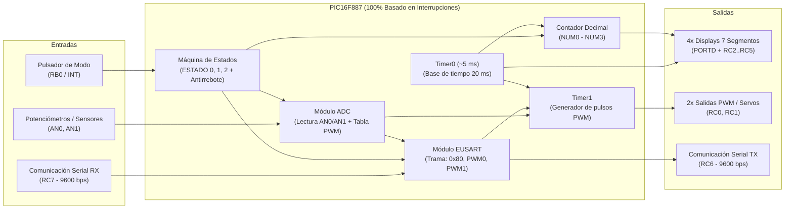
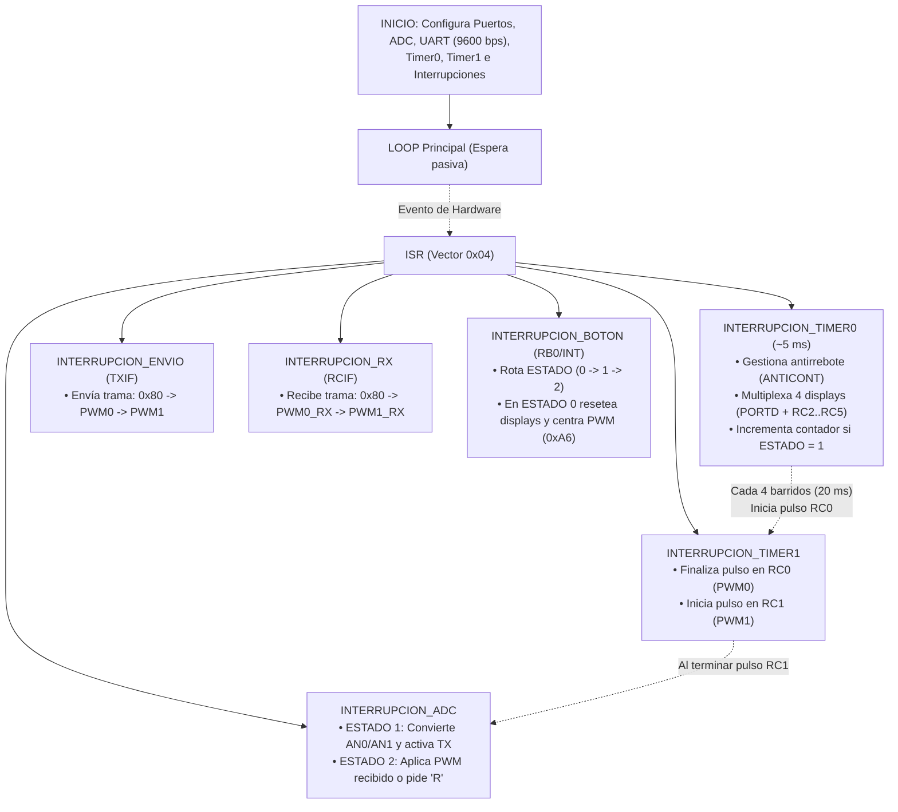
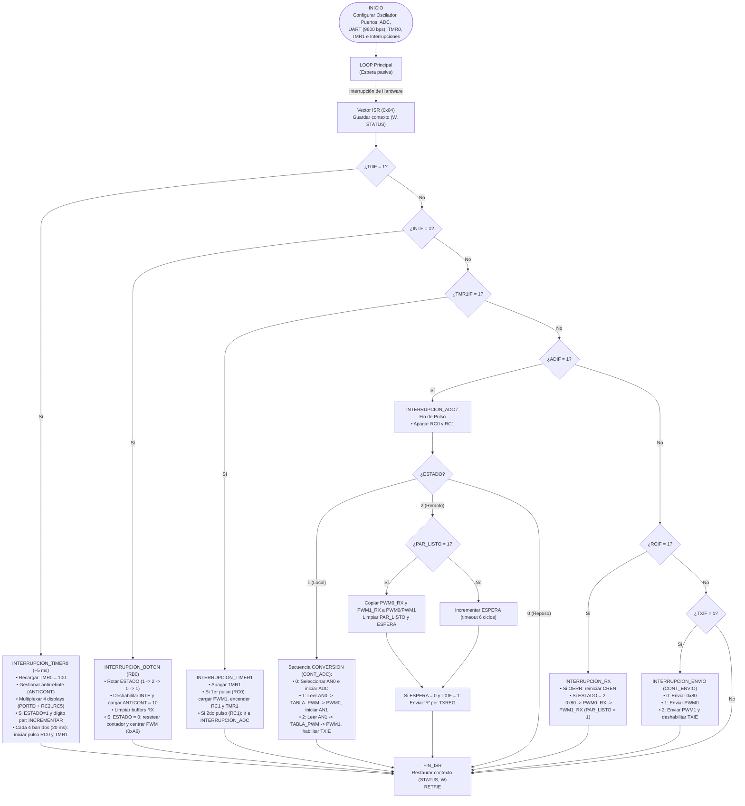

# Trabajo Final — Plataforma inclinable controlada por joystick


**Electrónica Digital 2** — Facultad de Ciencias Exactas, Físicas y Naturales — Universidad Nacional de Córdoba

> **Integrantes:** Paniagua Juan Cruz, Diaz Conde Juan Segundo, Espinoza Joaquin, Panoso Iris
>
> **Docente:** Ing. Marcos J. Blasco
>
> **Comisión:** COMUN-4.2


> **Estado del proyecto:** versión en desarrollo. Este documento describe el firmware tal como está implementado hoy y marca explícitamente lo que está pendiente (ver [Estado del desarrollo y trabajo futuro](#estado-del-desarrollo-y-trabajo-futuro)).

## Índice

- [Requisitos de la cátedra](#requisitos-de-la-cátedra)
- [Qué es PICLAB](#qué-es-piclab)
- [Capacidades del proyecto](#capacidades-del-proyecto)
- [Arquitectura y diagrama de bloques](#arquitectura-y-diagrama-de-bloques)
  - [Diagrama de bloques](#diagrama-de-bloques)
  - [Flujo de interrupciones](#flujo-de-interrupciones)
  - [Modos de operación](#modos-de-operación)
  - [Esquemático](#esquemático)
  - [Joystick y actuadores](#joystick-y-actuadores)
- [Cálculos de diseño](#cálculos-de-diseño)
- [Protocolo de comunicación UART](#protocolo-de-comunicación-uart)
- [Interfaz de usuario](#interfaz-de-usuario)
- [Especificaciones eléctricas y configuración](#especificaciones-eléctricas-y-configuración)
- [Ensayos y resultados](#ensayos-y-resultados)
- [Estado del desarrollo y trabajo futuro](#estado-del-desarrollo-y-trabajo-futuro)
- [Anexo: tabla de conversión](#anexo-tabla-de-conversión)
- [Material audiovisual](#material-audiovisual)

## Requisitos de la cátedra

El trabajo final debe cumplir los siguientes requisitos. La tabla resume cómo los aborda este proyecto.

| Requisito | Cómo se cumple en este proyecto |
|---|---|
| Comunicación serie entre el microcontrolador y la PC | EUSART del PIC16F887 en modo asincrónico, 9600 baudios, 8N1 (pines RC6/TX y RC7/RX). La transmisión PIC → PC (modo local) y la recepción PC → PIC (modo remoto) están implementadas, ambas por interrupción. |
| Interfaz de usuario | Aplicación de escritorio en la PC que monitorea la posición del joystick (modo local) y comanda la plataforma con un joystick virtual (modo remoto). Ver [Interfaz de usuario](#interfaz-de-usuario). |
| Protocolo de comunicación documentado en este README | Ver [Protocolo de comunicación UART](#protocolo-de-comunicación-uart). |
| Un sensor, de los vistos en clase | Joystick analógico de dos ejes (dos potenciómetros) leído con el conversor ADC (canales AN0 y AN1). |
| Un actuador, de los vistos en clase | Dos actuadores tipo servomotor SG90 comandados con señales PWM de 50 Hz generadas por software con TMR0 y TMR1. |

> El alcance y los detalles de cada trabajo se acuerdan con el docente de cada comisión.

## Qué es PICLAB

El sistema es una plataforma que se inclina en dos ejes a partir de la posición de un joystick analógico. El joystick está formado por dos potenciómetros, uno por eje, cuyas tensiones ingresan a dos canales del conversor analógico-digital (ADC) de un microcontrolador PIC16F887. El firmware convierte cada lectura en un ancho de pulso y lo entrega como una señal PWM de 50 Hz a cada actuador, de modo que la inclinación de la plataforma sigue la posición del joystick.

El firmware está escrito en ensamblador y funciona completamente por interrupciones: el lazo principal queda vacío y toda la temporización (generación de PWM, muestreo del ADC, multiplexado de displays, pulsador y comunicación serie) la resuelve una única rutina de servicio de interrupción.

Además del control local, el microcontrolador se comunica con una computadora mediante UART y puede operar en tres modos, que se alternan con un pulsador:

- **Local:** el joystick físico comanda la plataforma y el PIC envía su posición a la PC.
- **Remoto:** la plataforma sigue las posiciones que envía la PC, que el PIC solicita una a una.
- **Reposo:** la plataforma queda centrada y la comunicación se inactiva.

## Capacidades del proyecto

El sistema es capaz de:

- **Leer el joystick:** muestrea los canales AN0 (RA0) y AN1 (RA1) con el ADC, usando los 5 bits más significativos del resultado (ADRESH).
- **Generar dos señales PWM por software:** produce en RC0 y RC1 dos trenes de pulsos con período de ≈ 20 ms (≈ 50 Hz).
- **Actualizar la posición de forma sincronizada:** el ADC se muestrea (modo local) o se aplica la trama recibida (modo remoto) inmediatamente después de terminar los dos pulsos de cada período, por lo que los anchos nunca cambian en medio de un pulso.
- **Transmitir la posición por UART (modo local):** envía a la PC una trama de 3 bytes (`0x80`, `PWM0`, `PWM1`) en cada período de PWM, es decir, cada ≈ 20 ms, a 9600 baudios.
- **Recibir la posición desde la PC (modo remoto):** solicita una nueva posición enviando el carácter `'R'` y aplica la trama `0x80`, `PWM0`, `PWM1` que recibe como respuesta.
- **Operar en tres modos (`ESTADO`):** reposo (`0`), local (`1`) y remoto (`2`). El pulsador en RB0 los rota, con antirrebote por software de ≈ 50 ms.
- **Mostrar un contador en 4 displays de 7 segmentos:** multiplexados por Timer0, con formato `00.00` y paso de ≈ 10 ms. Cuenta en modo local, mantiene el valor en modo remoto y se pone en cero en reposo.

## Arquitectura y diagrama de bloques

### Diagrama de bloques



### Flujo de interrupciones



### Diagrama de flujo

### Modos de operación

El registro `ESTADO` define el modo. Arranca en `1` y el pulsador de RB0 lo rota en el orden `1 → 2 → 0 → 1`. La interrupción externa se deshabilita ≈ 50 ms después de cada pulsación (10 desbordes de Timer0) como antirrebote.

| `ESTADO` | Modo | Displays (`PORTD` / `RC2..RC5`) | Salidas PWM (`RC0`, `RC1`) | UART (`RC6`, `RC7`) |
| :---: | :--- | :--- | :--- | :--- |
| **`0`** | **Reposo / Reset** | Reiniciados en `00.00` | Pulso fijo centrado (`0xA6`, ≈ 720 µs) | Inactivo |
| **`1`** | **Local (Maestro)** | Cuenta ascendente automática | Controladas por ADC (`AN0`, `AN1`) | Envía trama `[0x80, PWM0, PWM1]` cada ≈ 20 ms |
| **`2`** | **Remoto (Esclavo)** | Mantiene último valor contado | Controladas por datos recibidos | Solicita `'R'` y recibe `[0x80, PWM0, PWM1]` |

### Esquemático

Esquemático del PIC:


Esquemático de los displays:


Diseño de las PCB (placa del PIC y placa de displays):


Placas grabadas:


### Joystick y actuadores

- **Joystick:** cada potenciómetro se conecta como divisor entre VDD y GND, con el cursor al pin analógico correspondiente (RA0 o RA1). Como la referencia del ADC es VDD/VSS, la tensión de salida del cursor se mide de forma ratiométrica respecto de la alimentación.
- **Actuadores:** reciben en su cable de señal el pulso de RC0 o RC1. Se recomienda alimentarlos desde una fuente externa con la masa común al PIC, para no cargar la alimentación del microcontrolador con la corriente de los motores.

## Cálculos de diseño

> Todos los cálculos asumen un cristal de **4 MHz** (modo XT), es decir, un ciclo de instrucción `T_inst` = 1 µs, y una alimentación de 5 V.

### TMR0: período de las señales PWM

Se busca una base de tiempo de 5 ms para que cuatro desbordes completen el período de 20 ms de la señal de los actuadores. Con prescaler 1:32:

$$
TMR0 = 256 - \frac{T/T_{inst} - 2}{PS}
= 256 - \frac{5000 - 2}{32} \approx 100
$$

Con la precarga 100, el desborde real y el período resultante son:

$$
T_{TMR0} = (256 - 100)\cdot 32 \cdot 1\,\mu s \approx 4{,}99\ ms
\qquad
T_{PWM} = 4 \cdot T_{TMR0} \approx 20\ ms \;\Rightarrow\; f \approx 50\ Hz
$$

### TMR1: ancho de pulso

TMR1 se configura con prescaler 1:8, por lo que cada cuenta dura 8 µs. Se carga `TMR1H = 0xFF` y `TMR1L = PWMx`, así que cuenta `256 − PWMx` ticks hasta desbordar:

$$
T_{pulso} = (256 - PWM_x)\cdot 8\,\mu s
$$

Con los valores de la tabla (`0xBC` a `0x91`):

$$
T_{pulso,min} = (256 - 188)\cdot 8\,\mu s = 544\,\mu s
\qquad
T_{pulso,max} = (256 - 145)\cdot 8\,\mu s = 888\,\mu s
$$

El recorrido de 344 µs se reparte en 32 posiciones, es decir, un paso de ≈ 11 µs. Como referencia, en un servomotor estándar de 544 a 2400 µs para 0° a 180°, este rango equivale a unos 33° de recorrido (≈ 1° por paso). **[COMPLETAR: verificar con el actuador real]**

El valor inicial tras el reset es `0xAD`, que corresponde a un pulso de 664 µs. En reposo (`ESTADO` = 0) el pulso se fija en `0xA6`, la posición central (≈ 720 µs).

### ADC

- **Referencias:** `ADCON1 = 0`, es decir, Vref+ = VDD y Vref− = VSS.
- **Justificación a la izquierda:** se usan solo los 8 bits de `ADRESH`.
- **Resolución:** el paso del ADC es 5 V / 256 ≈ 19,5 mV. Como se agrupan de a 8 cuentas para obtener 32 posiciones, cada posición de salida abarca ≈ 156 mV de entrada.
- **Reloj de conversión:** Fosc/8, es decir, T_AD = 8 / 4 MHz = 2 µs.
- **Tiempo de adquisición:** la rutina `DELAY` introduce 21 ciclos (≈ 21 µs) tras cada cambio de canal, antes de iniciar la conversión.

### UART: velocidad de transmisión

Con `BRGH = 1` y 9600 baudios:

$$
SPBRG = \frac{F_{osc}}{16 \cdot Baud} - 1 = \frac{4\times10^{6}}{16 \cdot 9600} - 1 = 25{,}04 \approx 25
$$

Verificación del error:

$$
Baud_{real} = \frac{4\times10^{6}}{16\cdot(25+1)} = 9615\ bps
\qquad
Error = \frac{9615 - 9600}{9600} \approx 0{,}16\,\%
$$

### Tiempos de la comunicación

En modo local, la transmisión se dispara una vez por período de PWM (en cada ejecución de `TERCER_ADC`):

$$
T_{envío} = 20\ ms \;\Rightarrow\; 50\ tramas/s
$$

Cada byte a 9600 baudios (10 bits con start y stop) ocupa ≈ 1,04 ms en la línea, por lo que la trama de 3 bytes ocupa ≈ 3,1 ms, alrededor del 16 % de cada período.

En modo remoto, si el PIC no recibe una trama completa, repite la solicitud `'R'` cada 6 períodos de PWM (≈ 120 ms).

### Displays y pulsador

- **Multiplexado:** cada desborde de Timer0 (≈ 5 ms) atiende un dígito, por lo que el conjunto de 4 dígitos se refresca cada ≈ 20 ms.
- **Contador:** la rutina `INCREMENTAR` se ejecuta dos veces por barrido, es decir, cada ≈ 10 ms. Con 4 dígitos cuenta de `00.00` a `99.99` (≈ 100 s) y vuelve a cero.
- **Antirrebote:** `ANTICONT` = 10 desbordes de Timer0, ≈ 50 ms con la interrupción de RB0 deshabilitada.

## Protocolo de comunicación UART

### Capa física y parámetros

| Parámetro | Valor |
|---|---|
| Tipo | Asincrónico (EUSART) |
| Velocidad | 9600 baudios (real 9615, error 0,16 %) |
| Formato | 8 bits de datos, sin paridad, 1 bit de stop (8N1) |
| Niveles | TTL (0 a 5 V) en RC6 y RC7. Se necesita un adaptador UART-USB (o equivalente) para conectar la PC. |
| Pines | RC6 = TX (PIC → PC), RC7 = RX (PC → PIC) |

### Resumen de mensajes

| Sentido | Mensaje | Cuándo | Descripción |
|---|---|---|---|
| PIC → PC | `0x80`, `PWM0`, `PWM1` | `ESTADO` 1, una vez cada ≈ 20 ms | Posición actual del joystick (trama de 3 bytes). |
| PIC → PC | `'R'` (`0x52`) | `ESTADO` 2, al terminar cada período de PWM si no hay una solicitud pendiente | Solicitud de una nueva posición. |
| PC → PIC | `0x80`, `PWM0`, `PWM1` | `ESTADO` 2, como respuesta a `'R'` | Posición que el PIC aplica a los actuadores. |

En `ESTADO` 0 el PIC no transmite y descarta los bytes que reciba. Lo mismo ocurre con los bytes recibidos en `ESTADO` 1.

### Formato de la trama

La misma trama se usa en ambos sentidos:

| Orden | Contenido | Rango |
|---|---|---|
| Byte 0 | Cabecera | `0x80` |
| Byte 1 | `PWM0`: precarga de `TMR1L` del canal 0 (RC0, entrada AN0) | `0x91` a `0xBC` |
| Byte 2 | `PWM1`: precarga de `TMR1L` del canal 1 (RC1, entrada AN1) | `0x91` a `0xBC` |

Los bytes de datos no son la lectura cruda del ADC, sino el valor ya convertido por la tabla de conversión. Como ningún valor de datos puede ser `0x80`, la cabecera identifica sin ambigüedad el inicio de cada trama. La PC los interpreta así:

```text
ancho_pulso_us = (256 - byte) * 8              ->  544 us a 888 us
posicion       = índice del byte en TABLA_PWM  ->  0 a 31 (ver Anexo)
```

### PIC → PC (modo local)

En `ESTADO` 1 el PIC termina los dos pulsos de PWM, convierte AN0 y AN1 y envía la trama por interrupción de transmisión (`TXIE` se habilita solo durante el envío). Cada trama sale en ≈ 3,1 ms y la siguiente llega ≈ 20 ms después.

### PC → PIC (modo remoto)

En `ESTADO` 2 el intercambio es de tipo solicitud-respuesta:

1. Al finalizar un período de PWM, el PIC envía `'R'`.
2. La PC responde con una única trama `0x80`, `PWM0`, `PWM1`.
3. El PIC recibe la trama por interrupción (`RCIE`) y, al terminar el siguiente período de PWM, copia los valores a `PWM0` y `PWM1`. Enseguida solicita la siguiente posición.
4. Si en 6 períodos (≈ 120 ms) no llegó una trama completa, el PIC repite la solicitud.

El receptor descarta los bytes que llegan antes de la cabecera `0x80`, por lo que se resincroniza solo. Ante un error de desbordamiento (`OERR`) reinicia el receptor (`CREN`) y espera una nueva cabecera.

### Limitaciones del protocolo actual

- **Sin verificación de errores:** no hay checksum ni confirmación de recepción. El PIC tampoco valida que `PWM0` y `PWM1` recibidos estén dentro de `0x91` a `0xBC`, por lo que la PC debe enviar solo valores de la tabla de conversión.
- **Modo del PIC no informado explícitamente:** la PC lo deduce del tráfico (tramas `0x80` → local, `'R'` → remoto, silencio → reposo o desconectado).
- **Información reducida:** se transmite la posición ya cuantizada (32 niveles), no la lectura de 8 bits del ADC.

## Interfaz de usuario

La interfaz es una aplicación de escritorio que se ejecuta en la PC y se comunica con el PIC a través del adaptador UART-USB (9600, 8N1). Cumple dos funciones: **monitorear** la posición del joystick cuando el PIC trabaja en modo local y **comandar** la plataforma cuando el PIC trabaja en modo remoto.

### Herramientas y ejecución

| Elemento | Detalle |
|---|---|
| Lenguaje | Python 3 |
| Comunicación serie | PySerial |
| Interfaz gráfica | **[COMPLETAR: biblioteca utilizada]** |
| Instalación | `pip install pyserial` |
| Ejecución | `python` **[COMPLETAR: nombre del archivo]**`.py` |

### Funciones

| Función | Modo del PIC | Descripción |
|---|---|---|
| Conexión serie | Todos | Lista los puertos disponibles, permite elegir uno y conectar o desconectar. Abre el puerto a 9600 baudios, 8N1. |
| Indicador de modo | Todos | Muestra **Local** si llegan tramas `0x80`, **Remoto** si llega `'R'` y **Sin datos** si no llega nada durante más de ≈ 250 ms (reposo o PIC desconectado). |
| Monitor de posición | `ESTADO` 1 | Sincroniza con la cabecera `0x80`, decodifica `PWM0` y `PWM1` y muestra, para cada canal, el byte recibido, el ancho de pulso en µs y la posición de 0 a 31. Representa ambos ejes como un punto en un plano X–Y. |
| Joystick virtual | `ESTADO` 2 | Permite fijar la posición de cada eje (0 a 31) con un área X–Y o dos deslizadores. La conversión a byte se hace con la tabla del [Anexo](#anexo-tabla-de-conversión). |
| Respuesta a solicitudes | `ESTADO` 2 | Envía una única trama `0x80`, `PWM0`, `PWM1` por cada `'R'` recibido, con la posición actual del joystick virtual. |
| Estadísticas del enlace | Todos | Muestra las tramas recibidas por segundo y los bytes descartados por falta de cabecera. |

### Uso

1. Conectar el adaptador UART-USB al PIC (RC6/TX, RC7/RX y masa común) y a la PC.
2. Ejecutar la aplicación, elegir el puerto serie y presionar **Conectar**.
3. Con el PIC en `ESTADO` 1 (modo inicial), mover el joystick físico y observar la posición de cada eje en la interfaz.
4. Presionar el pulsador de RB0: el PIC pasa a `ESTADO` 2 y la interfaz indica **Remoto**. Mover el joystick virtual para inclinar la plataforma.
5. Presionar nuevamente el pulsador: el PIC pasa a `ESTADO` 0, la plataforma se centra, los displays vuelven a `00.00` y la interfaz indica **Sin datos**.
6. Un nuevo pulso devuelve el PIC al modo local.

**[COMPLETAR: agregar captura de la aplicación en funcionamiento]**

## Especificaciones eléctricas y configuración

### Alimentación y herramientas

- **Tensión de operación:** 5 V (también es la referencia del ADC, ya que Vref+ = VDD).
- **Oscilador:** cristal de 4 MHz (modo XT).
- **Alimentación de los actuadores:** **[COMPLETAR]**
- **Consumo medido:** **[COMPLETAR]**
- **Herramientas de software:** **[COMPLETAR: MPLAB X IDE / versión del ensamblador]**
- **Hardware de programación y depuración:** **[COMPLETAR]**

### Bits de configuración

| Bit de configuración | Efecto |
|---|---|
| `_FOSC_XT` | Oscilador de cristal XT (hasta 4 MHz). |
| `_WDTE_OFF` | Watchdog deshabilitado. |
| `_PWRTE_OFF` | Power-up Timer deshabilitado. |
| `_MCLRE_ON` | RE3 funciona como MCLR (reset externo). |
| `_CP_OFF` y `_CPD_OFF` | Sin protección de código ni de datos. |
| `_BOREN_ON` y `_BOR4V_BOR40V` | Brown-out Reset habilitado con umbral de 4,0 V. |
| `_IESO_OFF` y `_FCMEN_OFF` | Sin cambio interno/externo de oscilador ni monitor de fallas de reloj. |
| `_LVP_OFF` | Programación en bajo voltaje deshabilitada (libera RB3 como pin de uso general). |
| `_WRT_OFF` | Sin protección de escritura de la memoria de programa. |

### Periféricos internos utilizados

| Periférico | Configuración |
|---|---|
| Entradas analógicas | `ANSEL`: AN0 y AN1 como analógicas; `ANSELH = 0`. |
| ADC | `ADCON0 = 0b01000001` (Fosc/8, canal AN0, módulo encendido). `ADCON1 = 0` (justificado a la izquierda, referencias VDD y VSS). Interrupción `ADIE` habilitada. |
| TMR0 | `OPTION_REG = 0b00000100`: modo temporizador, prescaler 1:32 asignado a TMR0. Precarga 100. Interrupción `T0IE` habilitada. Además, los pull-ups débiles de PORTB quedan habilitados (`RBPU = 0`). |
| TMR1 | `T1CON = 0b00110000`: reloj interno, prescaler 1:8, apagado hasta iniciar cada pulso. Interrupción `TMR1IE` habilitada. |
| Pulsador (RB0/INT) | `TRISB = 0b00000001` (RB0 como entrada) y `WPUB = 0b00000001` (pull-up solo en RB0). Interrupción externa `INTE` por flanco descendente (`INTEDG = 0`), deshabilitada ≈ 50 ms tras cada pulsación como antirrebote. |
| EUSART | `TXSTA = 0b00100100` (`TXEN = 1`, asincrónico, `BRGH = 1`), `SPBRG = 25`, `RCSTA = 0b10010000` (`SPEN = 1`, `CREN = 1`). `RCIE` habilitada desde la inicialización; `TXIE` se habilita solo durante el envío de cada trama. |
| Interrupciones | `GIE`, `PEIE`, `T0IE`, `INTE`, `TMR1IE`, `ADIE` y `RCIE` habilitados desde la inicialización; `TXIE` de forma dinámica. |

## Ensayos y resultados

Valores esperados según el diseño, para contrastar con las mediciones. **[COMPLETAR: columna "Medido" y capturas de osciloscopio]**

| Magnitud | Esperado | Medido |
|---|---|---|
| Período de la señal PWM (RC0 y RC1) | ≈ 20 ms (≈ 50 Hz) | **[COMPLETAR]** |
| Ancho de pulso mínimo | ≈ 544 µs | **[COMPLETAR]** |
| Ancho de pulso máximo | ≈ 888 µs | **[COMPLETAR]** |
| Ancho de pulso al reset (antes de la primera lectura) | ≈ 664 µs | **[COMPLETAR]** |
| Ancho de pulso en reposo (`ESTADO` 0, `0xA6`) | ≈ 720 µs | **[COMPLETAR]** |
| Desfase entre el pulso de RC0 y el de RC1 | Pulsos consecutivos, sin solaparse | **[COMPLETAR]** |
| Velocidad UART | 9600 baudios (≈ 9615 reales) | **[COMPLETAR]** |
| Período de envío por UART (`ESTADO` 1) | ≈ 20 ms por trama | **[COMPLETAR]** |
| Tramas recibidas en la PC | `0x80`, `PWM0`, `PWM1` con `PWM` dentro de `0x91` a `0xBC` | **[COMPLETAR]** |
| Respuesta a la solicitud `'R'` (`ESTADO` 2) | La plataforma sigue el joystick virtual | **[COMPLETAR]** |
| Antirrebote del pulsador | ≈ 50 ms, una transición de `ESTADO` por pulsación | **[COMPLETAR]** |
| Paso del contador de los displays | ≈ 10 ms | **[COMPLETAR]** |
| Respuesta de la plataforma a cada eje del joystick | Inclinación proporcional a la posición | **[COMPLETAR]** |

## Estado del desarrollo y trabajo futuro

| Función | Estado |
|---|---|
| Lectura del joystick con ADC (2 canales) | Implementado |
| Generación de 2 señales PWM de 50 Hz por software | Implementado |
| Actualización de PWM sincronizada con el período | Implementado |
| Transmisión UART PIC → PC | Implementado (trama de 3 bytes cada ≈ 20 ms en `ESTADO` 1) |
| Recepción UART PC → PIC | Implementado (solicitud `'R'` y trama de 3 bytes en `ESTADO` 2) |
| Trama con cabecera y sincronismo | Implementado (cabecera `0x80`) |
| Estados de operación (reposo, local, remoto) | Implementado (pulsador en RB0 con antirrebote) |
| Displays de 7 segmentos con contador | Implementado |
| Interfaz de usuario en la PC | Especificada en este documento. **[COMPLETAR: estado de la aplicación]** |
| Control de errores (checksum) | Pendiente |

Mejoras previstas:

- Agregar control de errores (checksum) a la trama y validar en el PIC que los valores recibidos estén dentro de `0x91` a `0xBC`.
- Informar el modo de operación a la PC de forma explícita, en lugar de deducirlo del tráfico.
- Completar la caracterización con mediciones sobre la plataforma real.

## Anexo: tabla de conversión

El firmware convierte los 5 bits más significativos del ADC (`ADRESH >> 3`, valores 0 a 31) en la precarga de `TMR1L` mediante `TABLA_PWM`. El ancho de pulso es `(256 − byte) · 8 µs`. La posición 16 corresponde al centro (`0xA6`).

| Pos. | Byte | Pulso (µs) | Pos. | Byte | Pulso (µs) |
|:---:|:---:|:---:|:---:|:---:|:---:|
| 0 | `0xBC` | 544 | 16 | `0xA6` | 720 |
| 1 | `0xBB` | 552 | 17 | `0xA4` | 736 |
| 2 | `0xB9` | 568 | 18 | `0xA3` | 744 |
| 3 | `0xB8` | 576 | 19 | `0xA2` | 752 |
| 4 | `0xB6` | 592 | 20 | `0xA0` | 768 |
| 5 | `0xB5` | 600 | 21 | `0x9F` | 776 |
| 6 | `0xB4` | 608 | 22 | `0x9D` | 792 |
| 7 | `0xB2` | 624 | 23 | `0x9C` | 800 |
| 8 | `0xB1` | 632 | 24 | `0x9B` | 808 |
| 9 | `0xAF` | 648 | 25 | `0x99` | 824 |
| 10 | `0xAE` | 656 | 26 | `0x98` | 832 |
| 11 | `0xAD` | 664 | 27 | `0x96` | 848 |
| 12 | `0xAB` | 680 | 28 | `0x95` | 856 |
| 13 | `0xAA` | 688 | 29 | `0x94` | 864 |
| 14 | `0xA9` | 696 | 30 | `0x92` | 880 |
| 15 | `0xA7` | 712 | 31 | `0x91` | 888 |

## Material audiovisual

Video de prueba:

https://github.com/user-attachments/assets/7c07650f-6239-457b-91fb-d6653ed256b7

Plataforma:


Laberinto:


