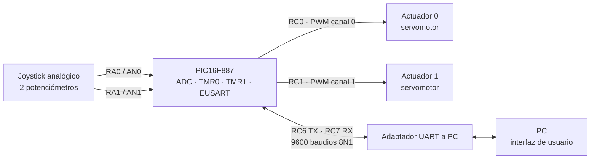
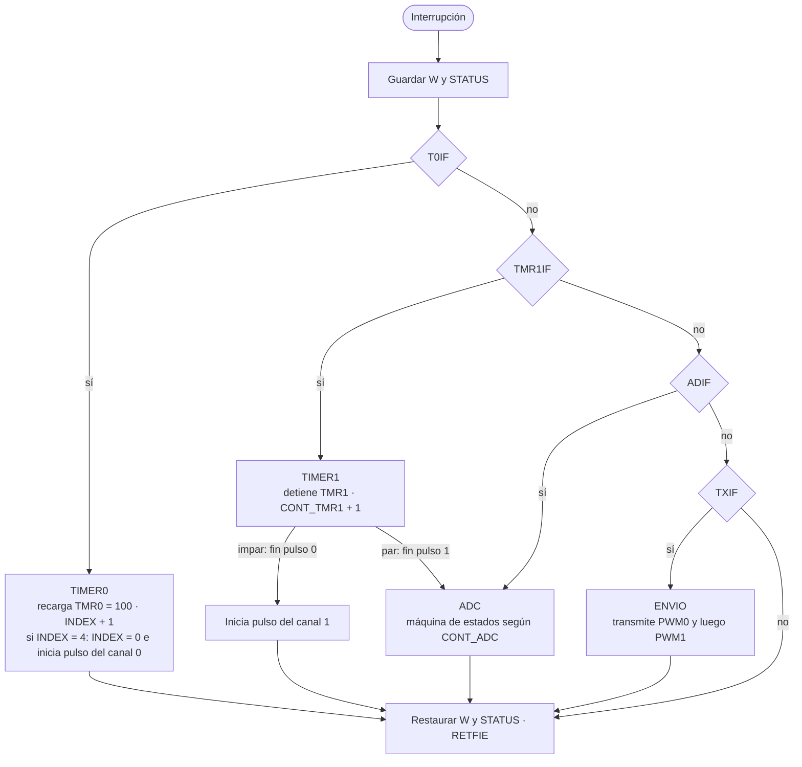
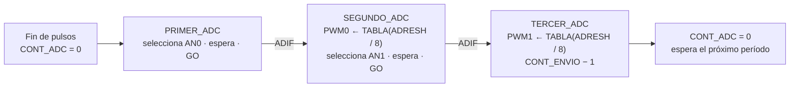

# Trabajo Final — Plataforma inclinable controlada por joystick

**Electrónica Digital 2** — Facultad de Ciencias Exactas, Físicas y Naturales — Universidad Nacional de Córdoba

> **Integrantes:** **[ Paniagua Juan Cruz, Diaz Conde Juan segundo, Espinoza Joaquin, Panoso Iris]**
> **Docente:** **[Ing. Marcos J. Blasco.]**
> **Comisión:** **[COMUN-4.2]**

> **Estado del proyecto:** versión en desarrollo. Este documento describe el firmware tal como está implementado hoy y marca explícitamente lo que está pendiente (ver [Estado del desarrollo y trabajo futuro](#estado-del-desarrollo-y-trabajo-futuro)).

# Índice

- [Requisitos de la cátedra](#requisitos-de-la-cátedra)
- [Que es PICLAB?](#Que-es-PICLAB?)
- [Capacidades del proyecto](#Capacidades-del-proyecto)
- [Arquitectura de hardware](#arquitectura-de-hardware)
- [Arquitectura de software](#arquitectura-de-software)
- [Cálculos de diseño](#cálculos-de-diseño)
- [Protocolo de comunicación UART](#protocolo-de-comunicación-uart)
- [Interfaz de usuario](#interfaz-de-usuario)
- [Especificaciones eléctricas y configuración](#especificaciones-eléctricas-y-configuración)
- [Ensayos y resultados](#ensayos-y-resultados)
- [Estado del desarrollo y trabajo futuro](#estado-del-desarrollo-y-trabajo-futuro)

## Requisitos de la cátedra

El trabajo final debe cumplir los siguientes requisitos. La tabla resume cómo los aborda este proyecto.

| Requisito | Cómo se cumple en este proyecto |
|---|---|
| Comunicación serie entre el microcontrolador y la PC | EUSART del PIC16F887 en modo asincrónico, 9600 baudios, 8N1 (pines RC6/TX y RC7/RX). La transmisión PIC → PC está implementada; la recepción PC → PIC está habilitada en hardware y pendiente en firmware. |
| Interfaz de usuario | **[COMPLETAR: descripción de la interfaz en la PC]** |
| Protocolo de comunicación documentado en este README | Ver [Protocolo de comunicación UART](#protocolo-de-comunicación-uart). |
| Un sensor, de los vistos en clase | Joystick analógico de dos ejes (dos potenciómetros) leído con el conversor ADC (canales AN0 y AN1). |
| Un actuador, de los vistos en clase | Dos actuadores tipo servomotor **[COMPLETAR: modelo]** comandados con señales PWM de 50 Hz generadas por software con TMR0 y TMR1. |

> El alcance y los detalles de cada trabajo se acuerdan con el docente de cada comisión.

## Que es PICLAB?

El sistema es una plataforma que se inclina en dos ejes a partir de la posición de un joystick analógico. El joystick está formado por dos potenciómetros, uno por eje, cuyas tensiones ingresan a dos canales del conversor analógico-digital (ADC) de un microcontrolador PIC16F887. El firmware convierte cada lectura en un ancho de pulso y lo entrega como una señal PWM de 50 Hz a cada actuador, de modo que la inclinación de la plataforma sigue la posición del joystick.

El firmware está escrito en ensamblador y funciona completamente por interrupciones: el lazo principal queda vacío y toda la temporización (generación de PWM, muestreo del ADC y transmisión serie) la resuelve una única rutina de servicio de interrupción.

Además del control local, el microcontrolador se comunica con una computadora mediante UART. Actualmente envía periódicamente la posición de cada canal para su visualización; la recepción de comandos y los distintos estados de operación se encuentran en desarrollo.

## Capacidad del proyecto

El sistema es capaz de:

- **Leer el joystick:** muestrea los canales AN0 (RA0) y AN1 (RA1) con el ADC, usando los 8 bits más significativos del resultado (ADRESH).
- **Generar dos señales PWM por software:** produce en RC0 y RC1 dos trenes de pulsos con período de ≈ 20 ms (≈ 50 Hz), cuyo ancho varía entre ≈ 544 µs y ≈ 888 µs en 32 posiciones discretas, usando TMR0 como base de tiempo del período y TMR1 para el ancho de cada pulso.
- **Actualizar la posición de forma sincronizada:** el ADC se muestrea inmediatamente después de terminar los dos pulsos de cada período, por lo que los anchos nunca cambian en medio de un pulso.
- **Transmitir la posición por UART:** cada ≈ 0,5 s envía a la PC dos bytes, uno por canal, a 9600 baudios.
- **Mantener un registro de estado (`ESTADO`):** con el bit 0 en 1 (valor inicial) el sistema procesa el joystick; con el bit 0 en 0 se omite el procesamiento del ADC.

El sistema **todavía no** es capaz de (versión en desarrollo):

- **Recibir comandos desde la PC:** el receptor del EUSART está habilitado, pero la rutina de interrupción aún no atiende la recepción.
- **Cambiar de estado de operación:** el firmware define el registro `ESTADO`, pero por ahora ninguna rutina lo modifica; permanece en el valor inicial.
- **Sincronizar la trama serie:** los dos bytes transmitidos no llevan cabecera ni terminador (ver [limitaciones del protocolo](#limitaciones-del-protocolo-actual)).

## Arquitectura de hardware

### Diagrama de bloques



### Asignación de pines

| Pin | Función | Dirección | Descripción |
|---|---|---|---|
| RA0 / AN0 | Entrada analógica | Entrada | Potenciómetro del eje 0 del joystick |
| RA1 / AN1 | Entrada analógica | Entrada | Potenciómetro del eje 1 del joystick |
| RC0 | PWM canal 0 | Salida | Señal de control del actuador 0 (pulso activo en alto) |
| RC1 | PWM canal 1 | Salida | Señal de control del actuador 1 (pulso activo en alto) |
| RC6 / TX | Transmisión serie | Salida | UART hacia la PC |
| RC7 / RX | Recepción serie | Entrada | UART desde la PC (habilitada, sin atender aún) |
| RE3 / MCLR | Reset externo | Entrada | `_MCLRE_ON`: el pin funciona como reset por hardware |

El resto de los pines no se utilizan en esta versión. En el puerto A, RA2 a RA7 quedan como salidas; en el puerto C, RC2 a RC5 también.

### Esquemático

**[COMPLETAR: insertar imagen del esquemático]**

### Joystick y actuadores

- **Joystick:** cada potenciómetro se conecta como divisor entre VDD y GND, con el cursor al pin analógico correspondiente (RA0 o RA1). Como la referencia del ADC es VDD/VSS, la tensión de salida del cursor se mide de forma ratiométrica respecto de la alimentación.
- **Actuadores:** reciben en su cable de señal el pulso de RC0 o RC1. Se recomienda alimentarlos desde una fuente externa con la masa común al PIC, para no cargar la alimentación del microcontrolador con la corriente de los motores. **[COMPLETAR: alimentación utilizada]**

## Arquitectura de software

### Visión general

El firmware (ensamblador de la familia PIC16, sintaxis MPASM con `p16f887.inc`) se organiza así:

- **Inicialización (`INICIO`):** configura entradas analógicas, EUSART, puertos, ADC, temporizadores e interrupciones, y habilita las interrupciones globales.
- **Lazo principal (`LOOP`):** `GOTO LOOP`. No realiza tareas.
- **Rutina de interrupción (`ISR`):** guarda `W` y `STATUS`, consulta las banderas por polling en un orden de prioridad fijo y restaura el contexto antes de `RETFIE`.
- **Retardo (`DELAY`):** espera de ≈ 21 µs (incluyendo `CALL` y `RETURN`) usada como tiempo de adquisición del ADC tras cambiar de canal.
- **Tabla de conversión (`TABLA_PWM`):** tabla de 32 entradas (`ADDWF PCL` + `RETLW`) que convierte la posición del joystick en el valor de precarga de TMR1.

### Rutina de interrupción y prioridades

Al existir un único vector de interrupción (0x04), la prioridad se resuelve por software, consultando las banderas en este orden:

1. **`T0IF` (TMR0):** base de tiempo del período de 20 ms; es la más crítica por su corta duración.
2. **`TMR1IF` (TMR1):** fin de cada pulso PWM.
3. **`ADIF` (ADC):** fin de conversión y avance de la máquina de estados del ADC.
4. **`TXIF` (transmisión):** carga del siguiente byte a enviar.



### Generación de las señales PWM

Cada actuador recibe una señal de ≈ 20 ms de período. Los pulsos de los dos canales se generan de forma **secuencial** (no simultánea), usando un único temporizador para el ancho:

1. **TMR0** desborda cada ≈ 5 ms. En cada desborde se recarga con 100 y se incrementa `INDEX`.
2. Cuando `INDEX` llega a 4 (≈ 20 ms), se pone `INDEX = 0`, se carga TMR1 con `0xFF:PWM0`, se pone RC0 en alto y se enciende TMR1.
3. Cuando TMR1 desborda (tras `(256 − PWM0) · 8 µs`), se apaga TMR1, se pone RC0 en bajo, RC1 en alto y se carga TMR1 con `0xFF:PWM1`.
4. Al segundo desborde de TMR1 (fin del pulso del canal 1) se pone RC1 en bajo y se ejecuta la máquina de estados del ADC.

El bit 0 de `CONT_TMR1` distingue ambos casos: valor impar = terminó el pulso del canal 0, valor par = terminó el pulso del canal 1.

### Lectura del ADC (máquina de estados)

La rutina `INTERRUPCION_ADC` se ejecuta con tres estados, seleccionados por `CONT_ADC` mediante un salto calculado (`ADDWF PCL`). Se entra a ella desde dos orígenes: al terminar los pulsos (rutina de TMR1) y al finalizar cada conversión (`ADIF`).



| `CONT_ADC` | Estado | Disparo | Acción |
|---|---|---|---|
| 0 | `PRIMER_ADC` | Fin de los dos pulsos PWM | Selecciona AN0, espera el tiempo de adquisición e inicia la conversión. |
| 1 | `SEGUNDO_ADC` | `ADIF` (terminó AN0) | Selecciona AN1 y espera adquisición. Calcula `PWM0` a partir de `ADRESH` (resultado de AN0) e inicia la conversión de AN1. |
| 2 | `TERCER_ADC` | `ADIF` (terminó AN1) | Calcula `PWM1` a partir de `ADRESH` (resultado de AN1). Decrementa `CONT_ENVIO`; al llegar a 0 habilita la interrupción de transmisión. |

Para convertir el resultado, `ADRESH` (0 a 255) se divide por 8 mediante tres rotaciones a la derecha, obteniendo un índice de 0 a 31 que se usa en `TABLA_PWM`. Un valor mayor de tensión en el potenciómetro produce un pulso más ancho. La tabla completa está en el [Anexo](#anexo-tabla-de-conversión).

Como el muestreo ocurre justo después de los pulsos, los valores nuevos se aplican en el período siguiente (≈ 20 ms después).

### Estados de operación

El registro `ESTADO` está reservado para los modos de funcionamiento.

| `ESTADO` | Significado | Situación |
|---|---|---|
| bit 0 = 1 | Control por joystick: se procesa el ADC y se actualizan `PWM0` y `PWM1`. | Valor inicial tras el reset. |
| bit 0 = 0 | Se omite el procesamiento del ADC (no se actualizan los anchos de pulso ni la cuenta de envío). | Definido en el firmware; todavía no hay rutina que lo active. |
| Resto de los bits | Estados adicionales. | **[COMPLETAR: estados definitivos del proyecto]** |

### Mapa de variables (RAM)

| Nombre | Dirección | Uso |
|---|---|---|
| `W_TEMP` | 0x70 | Copia de `W` durante la interrupción (RAM común a todos los bancos). |
| `STATUS_TEMP` | 0x71 | Copia de `STATUS` durante la interrupción. |
| `CONT1` | 0x20 | Contador del retardo `DELAY`. |
| `CONT2` | 0x21 | Declarado, sin uso en esta versión. |
| `CONT_TMR1` | 0x22 | Cuenta desbordes de TMR1; su bit 0 indica qué pulso terminó. |
| `CONT_ADC` | 0x23 | Estado de la máquina del ADC (0, 1 o 2). |
| `CONT_ENVIO` | 0x24 | Cuenta de períodos hasta la transmisión; luego índice del byte a enviar. |
| `PWM0` | 0x25 | Precarga de `TMR1L` del canal 0. |
| `PWM1` | 0x26 | Precarga de `TMR1L` del canal 1. |
| `INDEX` | 0x27 | Cuenta de desbordes de TMR0 (0 a 3). |
| `ESTADO` | 0x28 | Estado de operación. |

## Cálculos de diseño

> Todos los cálculos asumen un cristal de **4 MHz** (modo XT), es decir, un ciclo de instrucción `T_inst` = 1 µs, y una alimentación de 5 V.

### TMR0: período de las señales PWM

Se busca una base de tiempo de 5 ms para que cuatro desbordes completen el período de 20 ms de la señal de los actuadores. Con prescaler 1:32:

$$
TMR0 = 256 - \frac{T/T_{inst} - 2}{PS}
= 256 - \frac{5000 - 2}{32} \approx 100
$$

Con la precarga 100, el desborde real y el período resultante son:

$$
T_{TMR0} = (256 - 100)\cdot 32 \cdot 1\,\mu s \approx 4{,}99\ ms
\qquad
T_{PWM} = 4 \cdot T_{TMR0} \approx 20\ ms \;\Rightarrow\; f \approx 50\ Hz
$$

### TMR1: ancho de pulso

TMR1 se configura con prescaler 1:8, por lo que cada cuenta dura 8 µs. Se carga `TMR1H = 0xFF` y `TMR1L = PWMx`, así que cuenta `256 − PWMx` ticks hasta desbordar:

$$
T_{pulso} = (256 - PWM_x)\cdot 8\,\mu s
$$

Con los valores de la tabla (`0xBC` a `0x91`):

$$
T_{pulso,min} = (256 - 188)\cdot 8\,\mu s = 544\,\mu s
\qquad
T_{pulso,max} = (256 - 145)\cdot 8\,\mu s = 888\,\mu s
$$

El recorrido de 344 µs se reparte en 32 posiciones, es decir, un paso de ≈ 11 µs. Como referencia, en un servomotor estándar de 544 a 2400 µs para 0° a 180°, este rango equivale a unos 33° de recorrido (≈ 1° por paso). **[COMPLETAR: verificar con el actuador real]**

El valor inicial tras el reset es `0xAD`, que corresponde a un pulso de 664 µs.

### ADC

- **Referencias:** `ADCON1 = 0`, es decir, Vref+ = VDD y Vref− = VSS.
- **Justificación a la izquierda:** se usan solo los 8 bits de `ADRESH`.
- **Resolución:** el paso del ADC es 5 V / 256 ≈ 19,5 mV. Como se agrupan de a 8 cuentas para obtener 32 posiciones, cada posición de salida abarca ≈ 156 mV de entrada.
- **Reloj de conversión:** Fosc/8, es decir, T_AD = 8 / 4 MHz = 2 µs.
- **Tiempo de adquisición:** la rutina `DELAY` introduce 21 ciclos (≈ 21 µs) tras cada cambio de canal, antes de iniciar la conversión.

### UART: velocidad de transmisión

Con `BRGH = 1` y 9600 baudios:

$$
SPBRG = \frac{F_{osc}}{16 \cdot Baud} - 1 = \frac{4\times10^{6}}{16 \cdot 9600} - 1 = 25{,}04 \approx 25
$$

Verificación del error:

$$
Baud_{real} = \frac{4\times10^{6}}{16\cdot(25+1)} = 9615\ bps
\qquad
Error = \frac{9615 - 9600}{9600} \approx 0{,}16\,\%
$$

### Frecuencia de envío

La transmisión se dispara cada 25 ejecuciones de `TERCER_ADC`, una por período de PWM:

$$
T_{envío} = 25 \cdot 20\ ms \approx 0{,}5\ s
$$

Cada byte a 9600 baudios (10 bits con start y stop) ocupa ≈ 1,04 ms en la línea.

## Protocolo de comunicación UART

### Capa física y parámetros

| Parámetro | Valor |
|---|---|
| Tipo | Asincrónico (EUSART) |
| Velocidad | 9600 baudios (real 9615, error 0,16 %) |
| Formato | 8 bits de datos, sin paridad, 1 bit de stop (8N1) |
| Niveles | TTL (0 a 5 V) en RC6 y RC7. Se necesita un adaptador UART-USB (o equivalente) para conectar la PC. |
| Pines | RC6 = TX (PIC → PC), RC7 = RX (PC → PIC) |

### PIC → PC (implementado)

Cada ≈ 0,5 s el PIC envía **2 bytes consecutivos**, sin cabecera, sin terminador y sin checksum:

| Orden | Contenido | Rango |
|---|---|---|
| Byte 0 | `PWM0`: precarga de `TMR1L` del canal 0 (RC0, entrada AN0) | `0x91` a `0xBC` |
| Byte 1 | `PWM1`: precarga de `TMR1L` del canal 1 (RC1, entrada AN1) | `0x91` a `0xBC` |

Los bytes no son la lectura cruda del ADC, sino el valor ya convertido por la tabla de conversión. La PC los interpreta así:

```text
ancho_pulso_us = (256 - byte) * 8          ->  544 us a 888 us
posicion       = índice del byte en TABLA_PWM  ->  0 a 31 (ver Anexo)
```

Los dos bytes de un mismo par salen uno a continuación del otro (≈ 2 ms en total) y el siguiente par llega ≈ 0,5 s después.

Ejemplo de captura en la PC con PySerial (ilustrativo, sin sincronismo):

```python
import serial

with serial.Serial("COM3", 9600, timeout=2) as s:   # ajustar el puerto
    b0, b1 = s.read(2)
    ancho0_us = (256 - b0) * 8
    ancho1_us = (256 - b1) * 8
```

### PC → PIC (pendiente)

El receptor está habilitado (`RCSTA`: `SPEN = 1`, `CREN = 1`), pero la interrupción de recepción (`RCIE`) no está activada y la rutina de servicio no atiende `RCIF`. Por lo tanto, **el PIC ignora hoy cualquier byte que reciba**.

| Comando | Formato | Efecto |
|---|---|---|
| **[COMPLETAR]** | **[COMPLETAR]** | **[COMPLETAR: p. ej. cambio de estado o de modo de operación]** |

### Limitaciones del protocolo actual

- **Sin sincronismo de trama:** como los valores (`0x91` a `0xBC`) no se distinguen de un byte a otro, si la PC comienza a leer en medio de un par puede invertir los canales. Una forma de resincronizar con la trama actual es descartar bytes hasta detectar una pausa de ≈ 0,5 s entre pares.
- **Sin verificación de errores:** no hay checksum ni confirmación de recepción.
- **Información reducida:** se transmite la posición ya cuantizada (32 niveles), no la lectura de 8 bits del ADC.

## Interfaz de usuario

**[COMPLETAR: describir la aplicación en la PC (lenguaje, bibliotecas, funciones), cómo se ejecuta y agregar una captura de pantalla].**

Funciones que la interfaz debería cubrir según el protocolo actual: abrir el puerto serie a 9600 8N1, leer los pares de bytes y mostrar la posición de cada canal (ancho de pulso o posición 0 a 31).

## Especificaciones eléctricas y configuración

### Alimentación y herramientas

- **Tensión de operación:** 5 V (también es la referencia del ADC, ya que Vref+ = VDD).
- **Oscilador:** cristal de 4 MHz (modo XT).
- **Alimentación de los actuadores:** **[COMPLETAR]**
- **Consumo medido:** **[COMPLETAR]**
- **Herramientas de software:** **[COMPLETAR: MPLAB X IDE / versión del ensamblador]**
- **Hardware de programación y depuración:** **[COMPLETAR]**

### Bits de configuración

| Bit de configuración | Efecto |
|---|---|
| `_FOSC_XT` | Oscilador de cristal XT (hasta 4 MHz). |
| `_WDTE_OFF` | Watchdog deshabilitado. |
| `_PWRTE_OFF` | Power-up Timer deshabilitado. |
| `_MCLRE_ON` | RE3 funciona como MCLR (reset externo). |
| `_CP_OFF` y `_CPD_OFF` | Sin protección de código ni de datos. |
| `_BOREN_ON` y `_BOR4V_BOR40V` | Brown-out Reset habilitado con umbral de 4,0 V. |
| `_IESO_OFF` y `_FCMEN_OFF` | Sin cambio interno/externo de oscilador ni monitor de fallas de reloj. |
| `_LVP_OFF` | Programación en bajo voltaje deshabilitada (libera RB3 como pin de uso general). |
| `_WRT_OFF` | Sin protección de escritura de la memoria de programa. |

### Periféricos internos utilizados

| Periférico | Configuración |
|---|---|
| Entradas analógicas | `ANSEL`: AN0 y AN1 como analógicas; `ANSELH = 0`. |
| ADC | `ADCON0 = 0b01000001` (Fosc/8, canal AN0, módulo encendido). `ADCON1 = 0` (justificado a la izquierda, referencias VDD y VSS). Interrupción `ADIE` habilitada. |
| TMR0 | `OPTION_REG = 0b00000100`: modo temporizador, prescaler 1:32 asignado a TMR0. Precarga 100. Interrupción `T0IE` habilitada. Además, los pull-ups débiles de PORTB quedan habilitados (`RBPU = 0`), sin uso en esta versión. |
| TMR1 | `T1CON = 0b00110000`: reloj interno, prescaler 1:8, apagado hasta iniciar cada pulso. Interrupción `TMR1IE` habilitada. |
| EUSART | `TXSTA = 0b00100100` (`TXEN = 1`, asincrónico, `BRGH = 1`), `SPBRG = 25`, `RCSTA = 0b10010000` (`SPEN = 1`, `CREN = 1`). `TXIE` se habilita solo durante el envío. |
| Interrupciones | `GIE`, `PEIE`, `T0IE`, `TMR1IE`, `ADIE` habilitados desde la inicialización; `TXIE` de forma dinámica. |

## Ensayos y resultados

Valores esperados según el diseño, para contrastar con las mediciones. **[COMPLETAR: columna "Medido" y capturas de osciloscopio]**

| Magnitud | Esperado | Medido |
|---|---|---|
| Período de la señal PWM (RC0 y RC1) | ≈ 20 ms (≈ 50 Hz) | **[COMPLETAR]** |
| Ancho de pulso mínimo | ≈ 544 µs | **[COMPLETAR]** |
| Ancho de pulso máximo | ≈ 888 µs | **[COMPLETAR]** |
| Ancho de pulso al reset (antes de la primera lectura) | ≈ 664 µs | **[COMPLETAR]** |
| Desfase entre el pulso de RC0 y el de RC1 | Pulsos consecutivos, sin solaparse | **[COMPLETAR]** |
| Velocidad UART | 9600 baudios (≈ 9615 reales) | **[COMPLETAR]** |
| Período de envío por UART | ≈ 0,5 s | **[COMPLETAR]** |
| Bytes recibidos en la PC | Pares dentro de `0x91` a `0xBC` | **[COMPLETAR]** |
| Respuesta de la plataforma a cada eje del joystick | Inclinación proporcional a la posición | **[COMPLETAR]** |

## Estado del desarrollo y trabajo futuro

| Función | Estado |
|---|---|
| Lectura del joystick con ADC (2 canales) | Implementado |
| Generación de 2 señales PWM de 50 Hz por software | Implementado |
| Actualización de PWM sincronizada con el período | Implementado |
| Transmisión UART PIC → PC | Implementado (2 bytes cada ≈ 0,5 s) |
| Recepción UART PC → PIC | Pendiente (receptor habilitado, sin interrupción ni rutina) |
| Estados de operación | Parcial (solo `ESTADO` bit 0, sin rutina que lo modifique) |
| Interfaz de usuario en la PC | **[COMPLETAR]** |
| Trama con cabecera y sincronismo | Pendiente |

Mejoras previstas:

- Implementar la recepción por interrupción (`RCIE` y atención de `RCIF` en la ISR) y definir los comandos PC → PIC.
- Definir los estados de operación definitivos y las transiciones entre ellos.
- Agregar cabecera y control de errores a la trama transmitida.
- Completar la caracterización con mediciones sobre la plataforma real.

## Anexo: tabla de conversión

`TABLA_PWM` convierte el índice `ADRESH / 8` en el valor de precarga de `TMR1L`. El ancho de pulso se obtiene como `(256 − precarga) · 8 µs`.

<details>
<summary>Ver tabla completa (32 posiciones)</summary>

| Índice | `ADRESH` | Precarga (`PWMx`) | Ancho de pulso (µs) |
|---|---|---|---|
| 0 | 0–7 | 0xBC | 544 |
| 1 | 8–15 | 0xBB | 552 |
| 2 | 16–23 | 0xB9 | 568 |
| 3 | 24–31 | 0xB8 | 576 |
| 4 | 32–39 | 0xB6 | 592 |
| 5 | 40–47 | 0xB5 | 600 |
| 6 | 48–55 | 0xB4 | 608 |
| 7 | 56–63 | 0xB2 | 624 |
| 8 | 64–71 | 0xB1 | 632 |
| 9 | 72–79 | 0xAF | 648 |
| 10 | 80–87 | 0xAE | 656 |
| 11 | 88–95 | 0xAD | 664 |
| 12 | 96–103 | 0xAB | 680 |
| 13 | 104–111 | 0xAA | 688 |
| 14 | 112–119 | 0xA9 | 696 |
| 15 | 120–127 | 0xA7 | 712 |
| 16 | 128–135 | 0xA6 | 720 |
| 17 | 136–143 | 0xA4 | 736 |
| 18 | 144–151 | 0xA3 | 744 |
| 19 | 152–159 | 0xA2 | 752 |
| 20 | 160–167 | 0xA0 | 768 |
| 21 | 168–175 | 0x9F | 776 |
| 22 | 176–183 | 0x9D | 792 |
| 23 | 184–191 | 0x9C | 800 |
| 24 | 192–199 | 0x9B | 808 |
| 25 | 200–207 | 0x99 | 824 |
| 26 | 208–215 | 0x98 | 832 |
| 27 | 216–223 | 0x96 | 848 |
| 28 | 224–231 | 0x95 | 856 |
| 29 | 232–239 | 0x94 | 864 |
| 30 | 240–247 | 0x92 | 880 |
| 31 | 248–255 | 0x91 | 888 |

</details>
